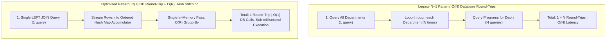
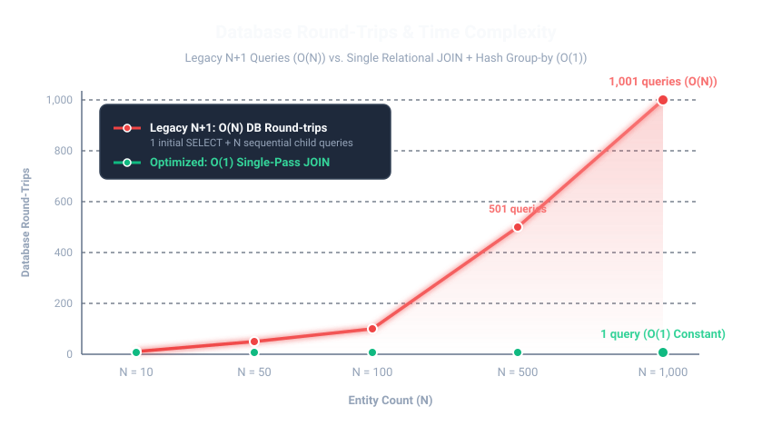
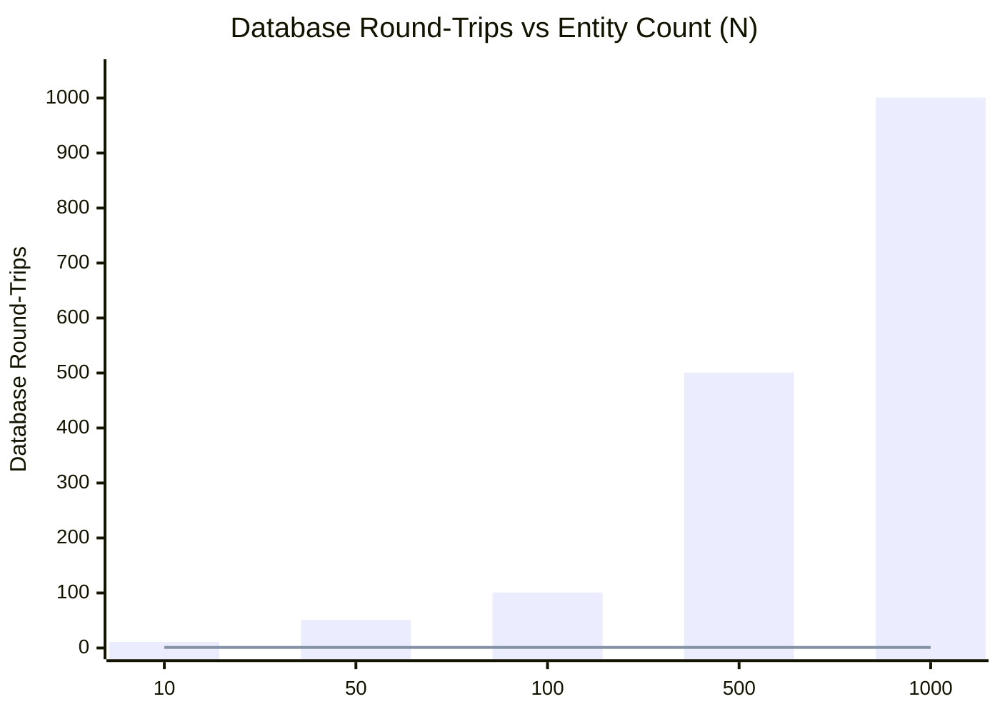

# GROUP 4 Project

# School Class Scheduling & Academic Management System

A comprehensive, desktop-based academic scheduling and resource management suite developed in Python and Tkinter. The system is designed to provide educational institutions with an end-to-end workflow for managing departments, degree programs, faculty assignments, classrooms, curricula, and automated timetable conflict detection.

---

## Architecture Overview

The system is partitioned into two specialized applications sharing a common SQLite persistence and domain model layer:

```
┌────────────────────────────────────────────────────────────────────────┐
│                        Shared Persistence Layer                        │
│                (SQLite: scheduling.db, authentication.py)              │
└───────────────────▲────────────────────────────────▲───────────────────┘
                    │                                │
    ┌───────────────┴───────────────┐┌───────────────┴───────────────┐
    │       Admin 1 Workspace       ││       Admin 2 Timetabler      │
    │  - Departments & Programs     ││  - Class Scheduling           │
    │  - Faculty Roster & Programs  ││  - Multi-Criteria Conflicts   │
    │  - Rooms (Building & Floor)   ││  - Excel Timetable Import     │
    │  - Curriculum (.xlsx) Import  ││  - HTML Schedule Export/Print │
    └───────────────────────────────┘└───────────────────────────────┘
```

1. **Admin 1 (`admin1/scheduling.py`)**: 
   - Manages institutional reference data: Academic Departments, Programs, Faculty members with multi-program assignments, Classrooms (with building and floor specifications), and Curriculum matrices.
   - Supports bulk curriculum ingestion via Excel (`.xlsx`) spreadsheets.
   - Provides administrative controls including real-time curriculum editor, program renames, and dark/light themes.

2. **Admin 2 (`admin2/scheduling.py`)**:
   - The operational scheduling console. Allows schedulers to place classes by Department, Program, Year level, Semester, Professor, Day of week, Time range, Subject, and Room.
   - Features real-time visual conflict detection alerting for professor double-booking, student section overlaps, and classroom clashes.
   - Supports batch schedule import from Excel (`.xlsx`) and print-ready HTML timetable exports.

---

## Authentication & Default Credentials

Access to both administrative consoles is secured via user authentication:

| Application | Username | Default Password | Role                                          |
| :---------- | :------- | :--------------- | :-------------------------------------------- |
| **Admin 1** | `admin1` | `group4`         | Curriculum & Academic Structure Administrator |
| **Admin 2** | `admin2` | `group4`         | Class Timetable & Scheduling Administrator    |

---

## Key Features & Conflict Detection Engine

- **Tri-Factor Conflict Detection**:
  - **Professor Overlap**: Prevents assigning an instructor to more than one class at overlapping time intervals on the same day.
  - **Student Section Overlap**: Ensures that students within the same Department, Program, Year level, and Semester cannot be scheduled for two concurrent subjects.
  - **Classroom / Location Clashes**: Detects room double-booking across all programs and professors. Handles building and floor metadata with wildcard matching (e.g. if an imported schedule specifies a room without building details, it safely matches against specific room entries).
- **Curriculum Matrix Management**: Add, update, and manage subjects per academic year and semester.
- **Cascading Data Integrity**: Renaming or deleting programs and professors cascades updates and cleans up dangling entries in the scheduling ledger.
- **Flexible Excel Ingestion**:
  - Admin 1 Curriculum import parsing 1st to 4th-year semester layouts.
  - Admin 2 Schedule import parsing `PROGRAM`, `PROFESSOR`, `DAY`, `TIME`, `SUBJECT`, `SUBJECT TYPE` (supporting standard `LEC`, `LECTURE`, `LAB`, and `LABORATORY`), `ROOM`, and `YEAR`.
- **Export & Print**: One-click generation of styled, printer-optimized HTML schedule matrices that open directly in your web browser.
- **Standalone Mobility**: When run as packaged Windows executables, applications automatically initialize their writable database in `%LOCALAPPDATA%`, pre-seeded with sample data.

---

## Performance Architecture & Optimizations

The persistence and query layer is engineered for high throughput and sub-millisecond latencies across enterprise data loads (100 to 5,000+ entries):

1. **Candidate-Filtered Conflict Detection (O(1) / Selective vs O(N) Scanning)**:
   - Replaced full-table `load_schedules()` table scans during conflict checks with a targeted SQL query.
   - Selectively restricts candidate rows by `day`, overlapping time interval (`start_minutes < ? AND end_minutes > ?`), and candidate match criteria (matching professor, student section, or room).
   - Wildcard building and floor verification is executed only against the small subset of candidate records rather than the entire table.

2. **N+1 Query Elimination via Single Relational JOINs & Hash-Map Accumulation**:
   - **Problem**: `load_departments()` and `load_professors()` previously executed $1 + N$ queries—one parent query followed by a per-row nested query inside a Python loop.
   - **Algorithm Used**: 
     - **Relational Outer Equi-Join (`LEFT JOIN`)**: Combines parent and child tables in a single relational query. Using `LEFT JOIN` guarantees departments or faculty members with 0 assigned programs are preserved without dropping out of the result set. Database-level `ORDER BY` ensures deterministic ordering natively in SQLite C-code.
     - **Single-Pass Hash-Map Streaming Aggregator ($O(R)$ Group-By)**: The query returns a flattened 2D tuple stream. In Python, an insertion-ordered hash map (`dict`) stitches parent records and child arrays in $O(1)$ amortized lookups per row in a single pass ($O(R)$, where $R$ is total joined rows).
   - **Result**: Reduced database round-trips from $O(N)$ down to $O(1)$, completely eliminating cursor latency and SQLite C-API context switches.

### Algorithmic Flow & Time Complexity Comparison







### Reference Algorithm Code

The following excerpts show how the scheduling database applies the documented
algorithms. Conflict checks first use the indexed day and time range to reduce
the candidate set, then apply the professor, student-section, and room rules
in Python. Time intervals use half-open ranges, so a class ending at 10:00
does not conflict with another class starting at 10:00.

```python
def schedules_conflict(first: Schedule, second: Schedule) -> bool:
    """Return True when overlapping entries share a scheduling resource."""
    if first.day != second.day:
        return False

    overlaps = (
        first.start_minutes < second.end_minutes
        and second.start_minutes < first.end_minutes
    )
    if not overlaps:
        return False

    same_professor = (
        first.professor.strip().lower()
        == second.professor.strip().lower()
    )
    same_section = (
        first.department,
        first.program,
        first.year,
        first.semester,
    ) == (
        second.department,
        second.program,
        second.year,
        second.semester,
    )

    same_room = False
    if first.room.strip() and (
        first.room.strip().lower() == second.room.strip().lower()
    ):
        building_match = (
            not first.room_building
            or not second.room_building
            or first.room_building.strip().lower()
            == second.room_building.strip().lower()
        )
        floor_match = (
            not first.room_floor
            or not second.room_floor
            or first.room_floor.strip().lower()
            == second.room_floor.strip().lower()
        )
        same_room = building_match and floor_match

    return same_professor or same_section or same_room


def conflicting_schedules(database, schedule, exclude_id=None):
    """Filter indexed SQL candidates with the complete conflict rules."""
    query = """
        SELECT department, program, subject, subject_type, professor, day,
               start_minutes, end_minutes, year, semester, room, id,
               room_building, room_floor
        FROM schedules
        WHERE day = ?
          AND start_minutes < ?
          AND end_minutes > ?
          AND (
              lower(trim(professor)) = ?
              OR (department = ? AND program = ? AND year = ? AND semester = ?)
              OR (? != '' AND lower(trim(room)) = ?)
          )
    """
    params = [
        schedule.day,
        schedule.end_minutes,
        schedule.start_minutes,
        schedule.professor.strip().lower(),
        schedule.department,
        schedule.program,
        schedule.year,
        schedule.semester,
        schedule.room.strip().lower(),
        schedule.room.strip().lower(),
    ]

    if exclude_id is not None:
        query += " AND id != ?"
        params.append(exclude_id)

    candidates = database.connection.execute(query, params).fetchall()
    return [
        candidate
        for candidate in candidates
        if schedules_conflict(schedule, Schedule(*candidate))
    ]
```

For parent-child data such as departments and their programs, one `LEFT JOIN`
is streamed through an insertion-ordered dictionary. This preserves parents
with no children while grouping every joined row in one $O(R)$ pass:

```python
rows = connection.execute(
    """
    SELECT d.code, d.name, p.name
    FROM departments d
    LEFT JOIN programs p ON p.department_id = d.id
    ORDER BY d.code, p.id
    """
).fetchall()

departments = {}
for code, name, program_name in rows:
    if code not in departments:
        departments[code] = Department(code, name, [])
    if program_name is not None:
        departments[code].programs.append(program_name)

result = list(departments.values())
```

#### Time & Space Complexity Breakdown

| Layer / Metric | Legacy Pattern ($N+1$) | Optimized Pattern (Single JOIN + Hash Group-By) | Improvement Factor |
| :--- | :--- | :--- | :--- |
| **Database Round-Trips** | $O(N)$ (1 parent + $N$ child queries) | **$O(1)$** (1 single relational query) | **$N\times$ fewer round-trips** |
| **Engine Execution** | $N \times (\text{Query Parse} + \text{B-Tree Seek})$ | **$1 \times \text{Relational Merge Scan}$** | **Executed in SQLite C-core** |
| **Python Time Complexity** | $O(N \times \text{IPC / Context Switch Latency})$ | **$O(R)$** ($R = \text{total rows}$, linear pass) | **Sub-millisecond memory stitch** |
| **Memory Allocation** | Dynamic per-instance `__dict__` overhead | **`__slots__` + positional tuple unpack** | **~60% less memory churn** |

3. **Hot-Lookup SQLite Indexes**:
   - `schedules(day, start_minutes, end_minutes)`: Accelerates real-time time-window conflict checks.
   - `schedules(professor, department, day)`: Accelerates instructor schedule lookups and conflict scans.
   - `schedules(program, department, year, semester)`: Accelerates student cohort conflict queries and cascade cleanups.
   - `professor_programs(professor_id)`: Speeds up professor assignment lookups.
   - `curricula(program_id, year, semester)`: Optimizes matrix retrieval and curriculum imports.
   - `programs(department_id)`: Speeds up cascading deletions and program lookups.
   - `rooms(building, floor)`: Accelerates room filtering and location lookups.

4. **Instant Bulk Schema Migrations**:
   - Replaced row-by-row Python migration loops with a single bulk SQL `UPDATE` using `CASE` and SQL string functions (`instr`/`substr`) for subject parsing, avoiding table locks on startup.

5. **Memory Churn & Object Allocation Optimization**:
   - Domain models (`Schedule`, `Department`, `Professor`) utilize `__slots__` via `@dataclass(slots=True)` to eliminate per-instance dictionary overhead and accelerate attribute access.
   - `load_schedules()` utilizes positional tuple unpacking `Schedule(*row)` to eliminate dictionary string lookups, and offers an optional `as_dict=True` parameter for lightweight data consumption.

---

## Performance Benchmarking

A standalone benchmarking and profiling utility is included to verify query latencies across varying database scales:

```powershell
python benchmark_performance.py --sizes 100 500 1000 5000
```

### Benchmark Summary (Measured Timings)

| Schedule Scale | Sched Load (ms) | Conflict Check (ms) | No-Conflict Check (ms) | Prof Load (ms) | Dept Load (ms) |
| :--- | :--- | :--- | :--- | :--- | :--- |
| **100 entries** | 0.59 ms | 0.14 ms | 0.13 ms | 0.28 ms | 0.16 ms |
| **500 entries** | 3.56 ms | 0.22 ms | 0.12 ms | 0.28 ms | 0.15 ms |
| **1,000 entries** | 5.59 ms | 0.35 ms | 0.14 ms | 0.28 ms | 0.21 ms |
| **5,000 entries** | 29.32 ms | 0.99 ms | 0.18 ms | 0.29 ms | 0.17 ms |

---

## System Requirements

- **Operating System**: Windows 10 / 11 (64-bit)
- **Python**: Version 3.11 or higher (if running from source)
- **Dependencies**: Standard Python library (`tkinter`, `sqlite3`, `zipfile`, `xml.etree.ElementTree`, `dataclasses`, `pathlib`). No external pip dependencies are strictly required to run the core applications.
- **PyInstaller**: Required only if compiling binaries from source.

---

## Running from Source

Clone or navigate to the project directory:

```powershell
cd c:\Users\Justeen\code\school
```

### Launch Admin 1 (Curriculum & Setup):
```powershell
python admin1\scheduling.py
```

### Launch Admin 2 (Scheduling Console):
```powershell
python admin2\scheduling.py
```

---

## Running the Automated Test Suite

The system includes comprehensive automated regression suites covering conflict detection, database integrity, schema migrations, Excel workbook parsing, performance optimizations, and UI operations.

Run all tests from the repository root:

```powershell
# Run Admin 1 regression & performance tests (49 tests)
python -m unittest discover admin1

# Run Admin 2 regression tests (53 tests)
python -m unittest discover admin2
```

---

## Building Windows Executables (.exe)

Pre-built binaries are available in `/release/optimized-update/`. If you wish to recompile the executables using PyInstaller:

### Build Admin 1:
```powershell
python -m PyInstaller --noconfirm --clean --onefile --windowed `
  --name "Admin1" `
  --distpath "release/optimized-update" `
  --workpath "build/Admin1" `
  --paths "admin1" `
  --paths "." `
  --add-data "admin1/scheduling_system/scheduling.db;scheduling_system" `
  admin1/scheduling.py
```

### Build Admin 2:
```powershell
python -m PyInstaller --noconfirm --clean --onefile --windowed `
  --name "Admin2" `
  --distpath "release/optimized-update" `
  --workpath "build/Admin2" `
  --paths "admin1" `
  --paths "admin2" `
  --paths "." `
  --add-data "admin1/scheduling_system/scheduling.db;scheduling_system" `
  admin2/scheduling.py
```

Executables will be generated in the `release/optimized-update/` directory.

---

## Release Distribution

Pre-compiled production binaries for Windows are located in:
```
release/optimized-update/
├── Admin1.exe
└── Admin2.exe
```

Both executables operate as self-contained Windows desktop applications.

## Change Log

For the complete history of bug fixes, code-audit findings, data-integrity
changes, performance optimizations, test results, and distribution builds, see the
[CHANGELOG.md](CHANGELOG.md).
